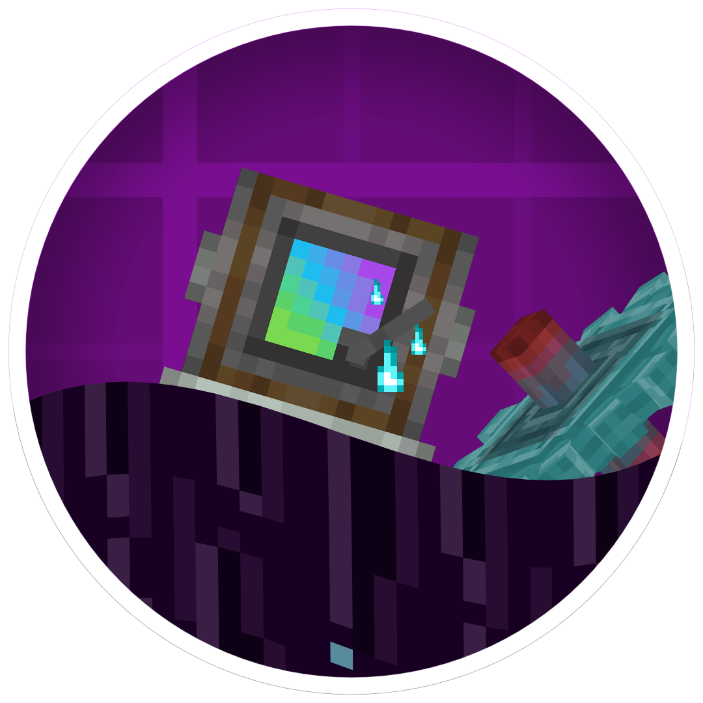

# Create Andertech | 机械动力：安德科技

Welcome to Create Andertech, an addon of Create that offers an overspeed variant of various Create machines,
while also adding machines that guides you to access overspeed machines, QoL machines,
and blocks featuring "End" and "Mythic" themes.
